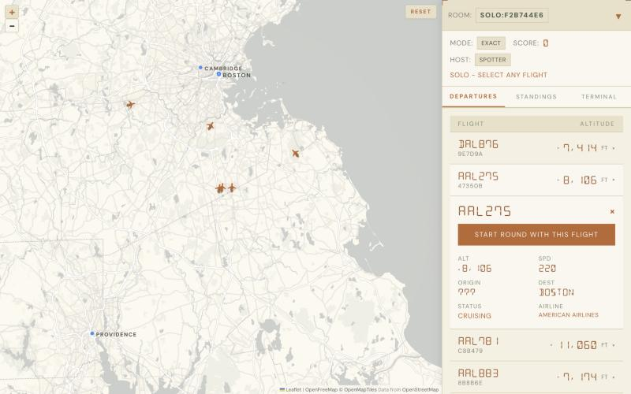

# AeroGuessr

[](https://github.com/tcole333/aeroguessr/actions/workflows/ci.yml)
[](https://github.com/tcole333/aeroguessr/releases)
[](https://codecov.io/gh/tcole333/aeroguessr)
[](LICENSE)

A real-time guessing game played on the planes overhead. An ADS-B receiver tracks the live air traffic around an airport. Players join a room from their phones and, for each flight, guess where it came from or where it's going. The closer the guess, the more points.



Play the maintainer's instance, over Boston Logan, at [aeroguessr.com](https://aeroguessr.com), or run your own on your ADS-B receiver.

This is an alpha, so expect rough edges. The self-hosting guide lists the [known limitations](docs/self-hosting.md#known-limitations).

## How to play

- **Create a room** and share its code, and friends join from their phones. Or start a **solo flight**.
- **The host picks a flight** on the map and starts a round. Everyone guesses the other end of its route: where an arrival came from, or where a departure is going.
- **Scoring:**
  - **Distance** mode gives up to 100 points, fewer the farther off the guess is, and none past 1,000 km.
  - **Exact** mode gives 100 for the right airport.
  - IATA and ICAO codes both work.

## Run it on your own receiver

You need:
- an RTL-SDR and a 1090 MHz antenna, with a feeder that decodes them: PiAware, readsb or ultrafeeder (adsb.im);
- a 64-bit Raspberry Pi 4 or 5 with 2 GB or more, or any 64-bit Linux machine (x86-64 or arm64);
- Docker;
- a FlightAware AeroAPI key for live rounds, because they need each flight's route and AeroAPI is the only route source.
  - FlightAware's ADS-B feeders get a monthly credit, and the budget settings cap the spend.
  - Demo mode needs no key.

AeroGuessr runs next to your feeder, from published images:
1. Download a release's `compose.yaml` and `.env` template into a directory.
2. Set your antenna's position and your airport in `.env`.
3. Run `docker compose up -d`, and open `http://<your machine>:8088/`.

[docs/self-hosting.md](docs/self-hosting.md) has the commands. It also covers every setting, route data (FlightAware AeroAPI), access from outside your network, updates and troubleshooting.

## Develop

You need [uv](https://docs.astral.sh/uv/), Node 22, and Docker for Redis. uv fetches Python 3.12 if it isn't installed. Demo mode makes up its own planes, so it needs no receiver and no API key.

```bash
scripts/worktree-setup.sh   # .venv (uv sync) and frontend/node_modules
make demo                   # then open the game's URL it prints; Ctrl-C stops
```

[CONTRIBUTING.md](CONTRIBUTING.md) covers the development setup, the tests, the conventions and the rules every change must keep.

## Docs

| Doc | What it covers |
|---|---|
| [docs/self-hosting.md](docs/self-hosting.md) | Running it on your own ADS-B receiver with the published images |
| [CONTRIBUTING.md](CONTRIBUTING.md) | Development setup, tests, conventions and common tasks |
| [docs/PRD.md](docs/PRD.md) | What the game does: rooms, rounds, scoring, answer secrecy, requirements |
| [docs/architecture.md](docs/architecture.md) | How it works: processes, wire contract, game engine, ingest, Redis keys, frontend |
| [docs/deployment.md](docs/deployment.md) | The aeroguessr.com runbook: the maintainer's Pi, auto-deploy, releases, Cloudflare Tunnel |
| [tests/README.md](tests/README.md) | Test suites, fixtures and CI |
| [docs/project-standards.md](docs/project-standards.md) | Coding and documentation conventions |
| [docs/api_openapi.yaml](docs/api_openapi.yaml), [docs/ws_schema.yaml](docs/ws_schema.yaml) | The generated REST and WebSocket contract |

Plans and known issues live in [GitHub issues](https://github.com/tcole333/aeroguessr/issues). To report a vulnerability, see [SECURITY.md](SECURITY.md).

## Credits

AeroGuessr is built on open data and open services:
- airports from [OurAirports](https://ourairports.com/data/), in the public domain;
- the map from [OpenFreeMap](https://openfreemap.org), with [OpenMapTiles](https://openmaptiles.org) and data © [OpenStreetMap](https://www.openstreetmap.org/copyright) contributors;
- routes from [FlightAware AeroAPI](https://www.flightaware.com/aeroapi/), with each operator using their own key.

[NOTICE.md](NOTICE.md) lists every third-party source, font and icon, with its license.

## License

MIT © 2025 Travis Cole; see [LICENSE](LICENSE). The third-party material [NOTICE.md](NOTICE.md) lists keeps its own license.
